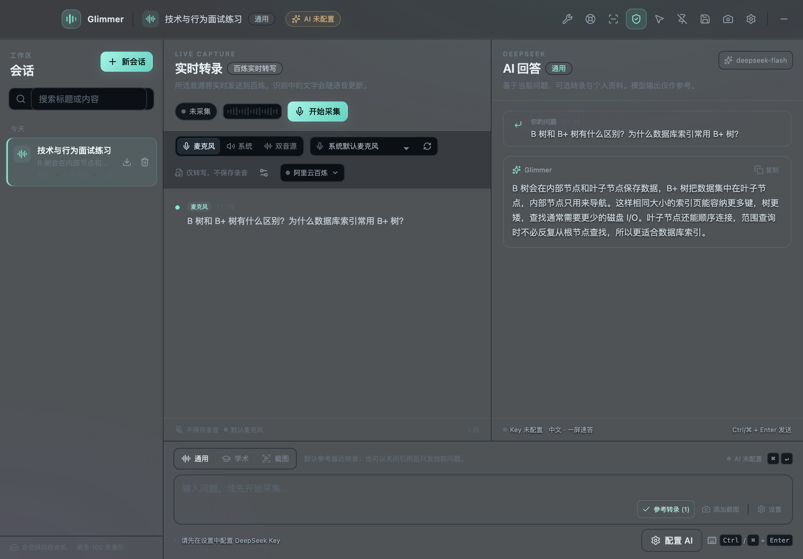
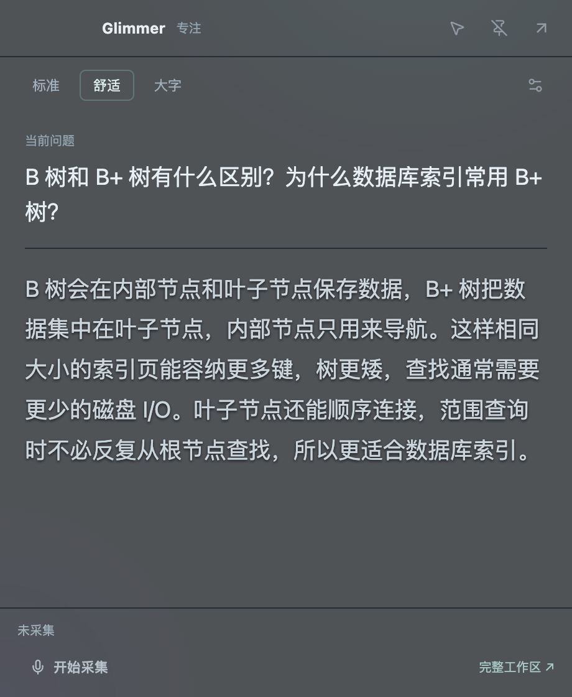
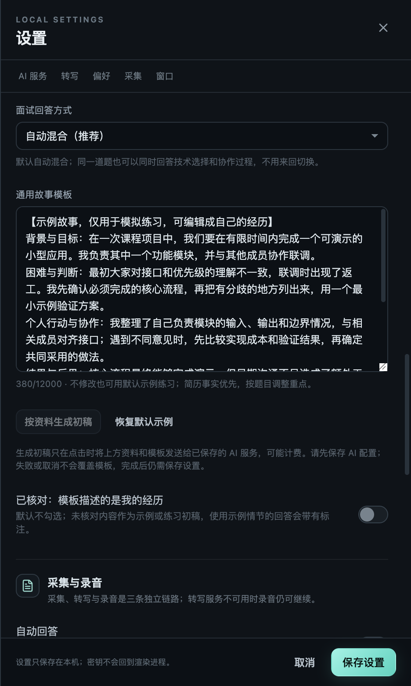

# Glimmer

把正在讨论的问题留在眼前，让回答跟上你的思路。

Glimmer 是一款中文桌面 AI 辅助工具，适合技术学习、模拟面试和资料讨论。它可以把选定音源转成文字，结合上下文识别问题，再把简短回答显示在透明浮窗中；技术题和行为题可以一起练习，也能直接打字提问。

**[下载 0.2.3 测试版](https://github.com/nku-jiahui/glimmer-releases/releases/tag/v0.2.3)** · [安装与配置教程](SETUP.md) · [完整使用手册](USAGE.md) · [常见问题](FAQ.md)

当前提供 **Windows x64** 和 **Mac M 系列芯片**安装包，无需源码或开发环境。AI 回答和语音转写需要配置自己的服务账号，调用费用由服务商收取；当前测试配置不要求激活码。Windows 包尚未完成真机与长期稳定性验收。

## 能帮你做什么

- **边看资料，边看回答**：工作区背景可调透明度，也能切到只显示问题与回答的专注浮窗，减少遮挡。
- **减少来回点击**：置顶、鼠标穿透与回答专用的 `↑ / ↓` 滚动，让阅读和操作更方便；穿透前先记住恢复键。
- **提供共享保护选项**：默认开启“请求排除屏幕共享”，效果受系统和软件影响，使用前从实际接收端确认。
- **说完问题，再组织答案**：转写定稿后结合上下文判断是否回答，支持短追问和复合问题；想只记录时可关闭自动回答。
- **用一份经历练习不同问题**：直接用默认示例，或导入简历生成可编辑初稿，按题目侧重点组织技术、行为及混合回答。
- **把自己的材料带进讨论**：本地资料检索、截图分析、会话回看、录音与导出，方便准备和复盘。

截图来自 Mac 版 0.2.3，文字为合成示例，用于展示布局，不代表真实模型效果。Windows 的窗口控件可能不同。

查看专注浮窗

专注模式保留当前问题、回答和必要控制，可调整字号，也可随时返回完整工作区。

## 下载安装

普通使用建议选安装器或 DMG，同一系统的安装包与 ZIP 二选一即可：

- **Windows x64**：[下载安装器 EXE](https://github.com/nku-jiahui/glimmer-releases/releases/download/v0.2.3/Glimmer-0.2.3-win-x64-setup.exe)。免安装试用可选 [Windows ZIP](https://github.com/nku-jiahui/glimmer-releases/releases/download/v0.2.3/Glimmer-0.2.3-win-x64.zip)。
- **Mac M 系列芯片（Apple silicon）**：[下载 DMG](https://github.com/nku-jiahui/glimmer-releases/releases/download/v0.2.3/Glimmer-0.2.3-arm64.dmg)，也可选择 [Mac ZIP](https://github.com/nku-jiahui/glimmer-releases/releases/download/v0.2.3/Glimmer-0.2.3-arm64-mac.zip)。
- **[SHA256 文件校验值](https://github.com/nku-jiahui/glimmer-releases/releases/download/v0.2.3/Glimmer-0.2.3-SHA256SUMS.txt)**：与完全相同文件名的那一行比对，检查下载文件是否一致。[核对方法](SETUP.md#先核对来源和文件指纹)。

在 Release 页面展开 **Assets** 即可下载，不需要 GitHub 账号。`Source code (zip/tar.gz)` 是说明仓库的文件快照，**不是应用安装包**。本轮没有 Intel Mac 安装包，Windows ARM 未验证。

### 第一次安装

Windows 运行 EXE，按向导安装；ZIP 版先右键“全部解压”，再打开文件夹中的 `Glimmer.exe`，不要在压缩包里运行，也不要只拿出一个 EXE。Mac 打开 DMG，将 `Glimmer.app` 拖入“应用程序”，再从那里启动。

当前测试包没有正式发行者签名，Mac 也没有 Apple 公证，系统可能提示未知发布者或无法验证开发者。这类提示不等于已经发现病毒，也不能据此认定文件安全；先确认来源和校验值，再按 [系统提示处理步骤](SETUP.md#系统拦截安装是什么意思) 操作。公司 / 学校管理的设备不允许安装时，联系管理员。

### 从旧版升级

先停止采集、回答和截图任务，等待保存；重要会话导出、录音另行备份，然后完全退出旧版。Windows 安装器按向导更新，ZIP 版解压到新目录；Mac 替换“应用程序”里的旧应用。不要同时运行两份 Glimmer，也不要混用新旧资源文件。

同一电脑和系统用户下沿用原资料目录，仍建议先备份。密钥框为空但显示“已配置”是正常的。目前从 Release **手动下载更新**；[完整升级步骤](SETUP.md#从旧版升级已经装过-glimmer)。

## 配置 AI 和语音识别

**AI 负责组织答案，语音识别负责把声音变成文字，两者独立配置。** 先配 AI 并手工提问成功，再接入语音，遇到问题更容易判断原因。

### 1. 配好 AI，先手工提问

到 [DeepSeek 开放平台](https://platform.deepseek.com/) 登录，在 [API Keys 页面](https://platform.deepseek.com/api_keys) 创建完整密钥，检查 API 权限和可用余额。网页上能聊天，不代表程序已经有 API 额度。

打开 Glimmer **设置 → DeepSeek 回答**：

- **服务地址**：`https://api.deepseek.com`
- **模型**：`deepseek-flash`
- **API Key**：粘贴你自己的完整 DeepSeek 密钥，不加引号或 `Bearer ` 前缀。

不要填网页聊天地址，也不要附加 `/chat/completions`。点 **保存设置**，看到“设置已保存到本机。”后，手工发送“B 树和 B+ 树有什么区别？”，确认能收到回答。纯文字提问不需要转写账号或麦克风权限。

密钥不会回显，留空保存表示保留；只有点“清除 Key”并保存才删除。密钥只填应用设置，不放进个人资料或反馈截图。[逐项配置与检查](SETUP.md#配置-ai-回答deepseek)。

### 2. 配好语音：普通用户选择百炼实时转写

到 [阿里云百炼](https://bailian.console.aliyun.com/) 开通自己的服务，按 [官方教程](https://help.aliyun.com/zh/model-studio/get-api-key) 取得 **华北 2（北京）**地域的百炼 API Key，检查模型权限和账户额度。

在 **设置 → 转写服务** 中填写：

- **转写提供方**：选择 **阿里云百炼（实时）**。
- **百炼 API Key**：填写北京地域的完整百炼 Key；它与 DeepSeek Key 不能互换。
- **业务空间 ID（可选）**：普通默认空间可先留空；指定空间按自己的真实空间 ID 和权限配置。

地址和 `paraformer-realtime-v2` 模型由程序处理，不需要填写兼容服务地址。保存后再试音；开始采集会发送所选音源到百炼，可能计费。[百炼申请与填写步骤](SETUP.md#方案-a配置阿里云百炼实时转写)。

高级选项：本机 / 兼容服务，需要自行部署

**普通安装后不能直接使用这一项。** Glimmer 没有内置 Whisper，也不会自动下载或启动语音模型。默认 `http://127.0.0.1:8000/v1` 只是本机服务地址；没有运行相应服务器时，请改用百炼。

已有兼容服务器时，填写真实基础地址、可用模型名及服务要求的 Key。兼容模式默认按6秒分段提交 WAV，与百炼实时流体验不同。[高级配置](SETUP.md#方案-b配置本机或兼容转写服务)。

## 完成第一次语音使用

自己朗读练习先选 **仅麦克风**。**仅系统声音**用于电脑里正在播放的声音；**双音源**分别转写两路，但只有系统声音的定稿触发自动回答，麦克风只补充上下文，不识别谁是面试官。

1. 在设置中选对音源和麦克风，先保持“自动回答”关闭。默认开启本地录音，不需要保存声音时可关闭。
2. 点击 **开始采集**，选择方向、回答偏好和模板，点 **保存并继续**。这一步只保存设置，**尚未开始录音**。
3. 再明确点击 **开始采集**，按系统提示授权，说一句完整试音，等待最终转写。
4. 转写正常后，停止采集，在设置中开启 **自动回答**并保存，再开始练习。说完问题并停顿，程序结合上下文判断“回答 / 等待补充 / 忽略”，再组织答案。
5. 阅读时用 `↑ / ↓` 滚动回答，或进入专注模式。一屏速答适合快速提示，口述回答适合组织表达，详细解析可能需要滚动。
6. 结束后明确 **停止采集**；答案还在输出时另点 **停止生成**，等待保存后再退出。

隐藏窗口不等于停止录音。顶栏 **配置与检查** 可检查已保存的服务配置，点击才发起请求，可能计费；转写检查使用合成静音，通过也不代表麦克风已经采到声音。[音源与完整操作](USAGE.md#音源怎么选)。

### 漏识别后，如何用麦克风补问

**双音源下，对着麦克风重复问题不会自动触发回答**，麦克风只补充上下文。仅麦克风模式开启自动回答后，重复问题的定稿会进入问题判断，但不保证每句话都会作答；仅系统声音模式不采集麦克风内容。

需要手动补问时：**重复问题 → 等待转写定稿 → 确认最新一条文字就是要问的问题 → 按默认快捷键发送**。Mac 为 **`⌘⇧Enter`**，Windows 为 **`Ctrl+Shift+Enter`**。

输入框有草稿时优先发送草稿；输入框为空时发送最新一条定稿，并不专门锁定麦克风。如果随后出现其他新片段，先把完整问题放进输入框再发送。[详细补问步骤](USAGE.md#漏识别时用麦克风重复补问)。

## 结合简历准备技术与行为面试

默认 **自动混合**，无需逐题切换：技术题讲原理和取舍，行为题讲经历中的行动、结果与反思，混合题同时覆盖两部分。

可以直接用默认课程项目示例练习，也可以在 **设置 → 偏好** 中准备自己的材料：

1. 在「个人资料 / 参考资料」粘贴或导入简历，支持 TXT、MD、PDF、DOCX，扫描 PDF 暂无 OCR。
2. 点击 **按资料生成初稿**，一次得到可编辑草稿，不需要先完成多轮问答。使用已保存的 AI 配置，发送当前资料和模板，可能计费。
3. 浏览并修改。核对确属自己的经历后，可打开「已核对：模板描述的是我的经历」，最后 **保存设置**。

不修改也能用默认示例练习；使用示例情节时回答应带“示例练习：”标记。简历事实优先，缺失信息要求保留【待补充】，仍需自己核对。模板可以复用结构和事实，不保证一个故事适合所有问题。

生成失败或取消时保留原模板，完成后也不会自动保存。[模板与练习详解](USAGE.md#行为面试题宝洁八大问等)。

查看故事模板设置

## 日常功能与便捷操作

- **透明与专注**：背景不透明度可调45%–100%，文字保持清晰；专注模式可选字号。[窗口设置](USAGE.md#透明浮窗和快捷键)。
- **鼠标穿透**：点击可落到下方应用。先确认恢复入口：Windows **`Ctrl+Alt+Esc`**，Mac **`⌘⇧Esc`**；也可从托盘恢复。恢复键会恢复窗口并停止当前任务；同时采集和回答时先停止回答，采集仍需明确停止。
- **回答专用滚动**：浮窗可见时裸 `↑ / ↓` 可能全局占用。填写 Glimmer 输入框、打开工具、隐藏或最小化时释放；需要在其他软件正常使用方向键时，先隐藏 / 最小化 Glimmer，或改绑组合键。上滑暂停追随新输出，回到底部恢复。
- **本地资料库**：导入资料并开启“回答时参考知识库”，按关键词选取相关片段，回答下可查看来源。它是检索，不是训练模型。[知识库说明](USAGE.md#本地知识库)。
- **截图分析**：选择屏幕、裁剪和排序后提问，模型需要支持图片。多组分析会增加请求；没有后台自动截图或自动长图拼接。[截图操作](USAGE.md#截图分析)。
- **回看与导出**：搜索会话、播放已完成录音，按需导出 Markdown、TXT 或 JSON。[回看操作](USAGE.md#会话录音与导出)。

## 数据、费用与使用边界

- **数据去向**：音频发送给选中的转写服务；问题、相关上下文、个人资料、选用的知识库片段或截图发送给配置的 AI。录音保存在本机，不代表整个流程离线。
- **服务费用**：转写、问题判断、回答、简历初稿、截图分析及主动连接检查都可能计费，以各服务商账户为准。当前测试版不要求激活码，正式购买和自动更新服务尚未上线。
- **个人资料**：密钥受系统安全存储保护，不代表全部会话、文档和录音都已加密。删除会话不自动删除 WAV；导出不会自动脱敏，分享前检查内容。
- **共享保护**：“请求排除屏幕共享”默认开启，但不能保证所有截图或共享方式都隐藏 Glimmer。透明、置顶、穿透和内容保护是独立功能；请从实际接收端分别验证整屏 / 单窗口共享及截图。
- **测试范围**：Mac 是主要验证环境；Windows 包已构建并检查，真机安装、音频、共享保护和长期稳定性仍需反馈。模型可能误听、漏答或生成不准确内容，重要事实需核对。

只在参与者知情、场景允许的情况下采集和使用资料。[完整数据与恢复说明](USAGE.md#数据费用与使用注意)。

## 常见问题、更新与反馈

- 打字提问也没答案：先检查 AI 地址、模型、密钥、余额和网络，不必先排查麦克风。
- 报 localhost 连接失败：没有运行本机转写服务时，改选百炼并配置自己的 Key。
- 有转写却没自动回答：检查自动回答开关、是否已定稿、音源，以及是否有未发送草稿；双音源只由系统声音触发。
- 穿透后点不到窗口：使用上述固定恢复键或托盘恢复，再确认任务是否停止。

[查看全部常见问题](FAQ.md) · [查看版本说明](https://github.com/nku-jiahui/glimmer-releases/releases/tag/v0.2.3) · [提交问题](https://github.com/nku-jiahui/glimmer-releases/issues/new) · [稳定性测试](STABILITY.md)

反馈请提供应用版本、系统与架构、音源及转写提供方、复现步骤、预期与实际、错误文字。截图遮住个人信息，不提交密钥、完整简历、用户资料目录或真实录音。
